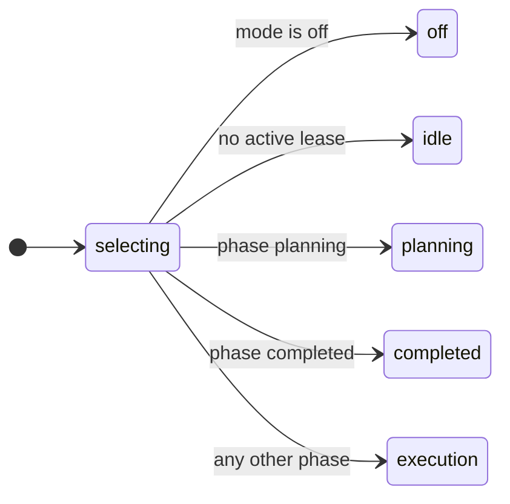
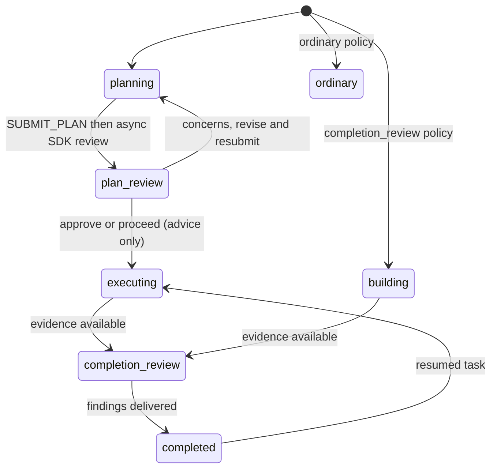
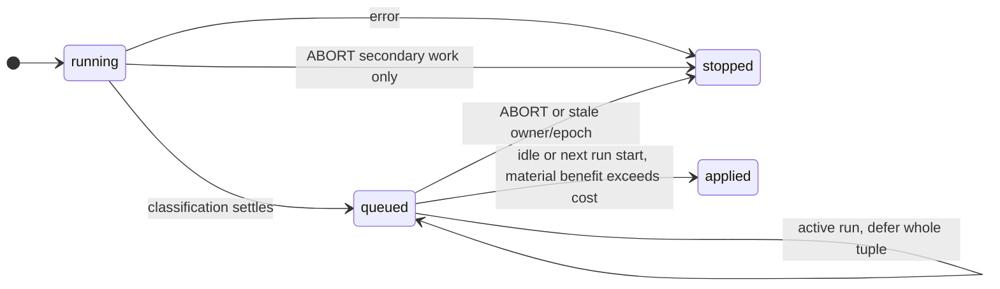

# Model-aware router

A task-leased, model-aware routing extension for Pi **1.2.0 or newer**. Pi 1.2.0 introduced custom-start
`before_agent_start` preparation and busy-start semantics that this router relies on. The installer refuses older hosts,
and the router also rejects them when loaded directly. It classifies semantic task features, applies deterministic
eligibility/ranking policy, selects a versioned model prompt profile, and records an audit trail.

The extension starts in **shadow mode**: it logs and displays the route but does not change the model, effort, or system
prompt. Like off mode, shadow exposes no router-only tools. Router safety is **advisory-only in every mode** and never
blocks tool calls, even when a safety lease is persisted. Shadow continues to record routing telemetry.

## Repository contract

The router has no dependency on an untracked design document or local conversation export. Its checked-in authorities
are:

- the [functional specification](../../specs/routing-layer/SPEC.md),
  [source basis](../../specs/routing-layer/source-basis.md), and generated-table
  [model and endpoint evidence](../../specs/routing-layer/model-evidence-2026-08-11.md);
- the executable [feature](core/features.ts), [synopsis](core/synopsis.ts), [policy](core/policy.ts), and
  [prompt-profile](core/profiles.ts) contracts;
- the [architecture decisions](../../specs/routing-layer/decisions.md),
  [implementation record](../../specs/routing-layer/implementation-plan.md), and
  [evaluation contract](../../specs/routing-layer/eval.md).

The source-basis document records the historical inputs that were incorporated and links the public provider, benchmark,
Bifrost, and telemetry references. If prose and executable contracts diverge, treat that as a repository bug; do not
reconstruct behavior from the historical export.

## Commands

- `/route` — show the current mode, task lease, model, effort, profile, and attempt.
- `/route shadow|active|off` — change mode for this session.
- `/route reset` — clear the lease; the next user message starts a new task.
- `/route accept|reject` — label the most recent attempt for telemetry maturity.
- `/route fail availability|quality|deterministic_verification` — apply the authorized sequential fallback. Ordinary
  routes continue through every eligible, policy-authorized provider endpoint before restoring the prior selection.

`/route off` is an immediate bypass for this extension within the running session. It discards any pending route,
removes every router-only tool (including `submit_implementation_plan`), and stops classification, prompt compilation,
automatic model/effort changes, manual selection tracking, lifecycle advice and evidence collection, fallbacks/reviews,
`/route accept|reject|fail`, and all router telemetry. It aborts pending secondary reconciliation, discarding stale
corrections without retaining a safety latch. Other routing work already in flight is not cancelled, but its result is
discarded: it installs no lease, applies no model or effort, returns no prompt, re-exposes no tools, and submits no new
telemetry, even if routing is re-enabled before it finishes. Telemetry writes and spans already accepted before off may
still finish. The last lease remains dormant so `/route active` can safely restore the existing lifecycle; while off,
the router does not restrict models, reasoning efforts, ordinary tools, or turns.

Planning routes must call `submit_implementation_plan`; the tool validates the PR dependency DAG, acceptance criteria,
rollout, and rollback. A normal response that omits the tool gets one same-lease corrective follow-up before the bounded
fallback policy applies. A request to start implementation always receives a new lease.

Safety is an explicit persisted **advisory** lease lifecycle, not an inference from archetype or parent linkage:

- High-risk code builders implement first, record a repository delta and passing deterministic checks, and then receive
  a read-only, provider-independent completion review.
- High-risk irreversible actions and high-risk reversible non-code work use one `plan_review_then_completion_review`
  policy. In `planning`, inspect preconditions and call `submit_action_plan` with targets, steps, effects, verification,
  rollback, abort conditions, and `toolNames`. The different-vendor review gives advice, not permission. Approval
  advances to `executing`; concerns recommend revising and resubmitting. No phase blocks tools or narrows the builder's
  tool set. Only router-owned validators are shown or hidden by phase.
- Automatic completion reviews remain limited to the existing high-risk policies. Missing action plans, possible
  mutations during a pending plan review, and missing completion evidence produce human-facing warning notes and
  `advisory_step_skipped` telemetry at most once per step per lease. Mutation detection is heuristic. These skipped
  steps send no model-facing repair follow-ups; implementation-plan repair and deterministic check-failure fallback
  remain unchanged. Work executed in `planning` without an action plan is noted and still receives a completion review.
  A rejected plan review drops the unaccepted plan. A verdictless review retains the plan as context, with a persisted
  attempt identity preventing replay; later builder settlement reviews recorded work rather than retrying the old plan.
  Both paths preserve mutation evidence and remain completion-review eligible across reload.
- `submit_discovery_request`, single-use discovery grants, and authorization grants have been removed. Old persisted
  discovery/grant state and both old pre-action policies migrate to empty `planning`. Historical telemetry still parses.
  Old action-plan callers use `toolNames` instead of `authorizedToolNames`; irreversible steps are no longer mandatory.

`submit_implementation_plan` validates implementation-plan DAGs throughout active routing, including a planning
follow-up kept on a research lease. It preserves the task and model and grants no execution permission. Planning routes
still require validation; telemetry records `planningLease` to distinguish other routes' optional submissions.

- Unattended or indefinite external-effect loops retain pre-action advice and completion review even at medium
  classifier risk; this is not authorization.
- The classifier rates `actionMode` and `risk` by what the agent itself is asked to execute, not by what a later human
  review, merge, `terraform apply`, or deploy does with the output. Local edits, commits, non-force pushes to a
  non-default branch, and opening, updating, or marking pull requests ready are `reversible_mutation` at any scale, so
  editing infrastructure-as-code or organization-settings code through a pull request is ordinary coding work. Running
  `terraform apply`, deploys, publishes, auto-deploying merges, or live `kubectl`/cloud mutations is external or
  destructive, as are force-pushes or rewrites of shared branches and hard resets that discard unpushed work.
- Ordinary and non-destructive work is unchanged.

Manual model/effort selection preserves that explicit selection, not the semantic identity of the previous task. A
nontrivial subsequent request still receives continuity classification; when it is a new task, the router creates a
fresh lease and safety lifecycle while carrying the selected model/effort into that lease.

## Continuity fast paths and classifier deadline

For ordinary, nonqueued interactive user input with an existing lease, the boundary gate handles only two narrow prompt
classes without an LLM call: anchored confirmations such as `continue` or `go ahead`, and an anchored allowlist of
same-task implementation operations such as rerunning checks, fixing reported failures/findings, or committing the
completed change. The operation shortcut applies only to a mutation-capable code-builder lease whose policy archetype
mutates the repository. Within that ordinary-input path, hard boundaries precede prompt matching; explicit topic
changes, planning-to-implementation transitions, incompatible planning/review/read-only leases, and topic-bearing near
matches still create or classify a boundary. Queued steer/follow-up input is a separate continuation path evaluated
before pending hard boundaries, because it is delivered into a turn that is already running; that path is delivery-based
and applies to queued input of any origin, including an extension's `sendUserMessage`. It skips semantic reevaluation,
not capability checks: images that the leased model cannot accept still force a new task, because no route can serve
that turn otherwise. These shortcuts retain a lease; they never grant permissions or bypass Pi's configured tool
controls.

Extension-generated input is not privileged. pi marks a turn `source: "extension"` when any extension calls
`sendUserMessage`, and while the agent is idle such input runs the ordinary prompt path with no `streamingBehavior`, so
it is indistinguishable from typed input apart from the label. It is therefore evaluated exactly like ordinary input: it
cannot outrank a pending hard boundary, cannot silently inherit the active lease, and makes pending review advice stale
the same way a typed message does. The router's own continuations (plan advice, completion findings, and post-fallback)
are custom `model-router-context` messages, which never surface as an input event and so keep their lease without
relying on any source exemption.

Every router-level fresh-task or continuity classification is bounded by router-owned stage deadlines. Rather than
sharing a single combined timer across primary classification and escalation, each classification stage of a synchronous
classifier invocation receives an independent timeout budget configured in code
([`CLASSIFICATION_STAGE_TIMEOUT_MS`](index.ts)). That constant owns fresh-task primary classification and continuity
classification, which still escalates primary to secondary inside the same invocation, so the secondary stage there
starts a fresh budget.

There are two timeout owners, and changing one does not affect the other. Background fresh-task secondary reconciliation
runs as a separate classifier invocation bounded by the configurable
[`secondaryReconciliationPolicy.secondaryDeadlineMs`](core/reconciliation.ts), not by `CLASSIFICATION_STAGE_TIMEOUT_MS`.
The primary is trusted immediately, including with cached context and low confidence: there is no secondary grace wait.
The secondary runs in the background until its deadline and may reconcile at a later safe boundary. Because the two
budgets differ, every `secondary_reconciliation` record states the budget it was running against in
`secondaryDeadlineMs`; a run that did not succeed also records `secondaryOutcome`, `secondaryWallLatencyMs`, and the
bounded `secondaryErrorCategory`, plus `secondaryEnforcedBudgetMs` and `secondaryDeadlineStage` when a router-owned
deadline elapsed. A `secondary_timeout` is therefore attributable to a budget without cross-referencing the paired
`classifier_invocation`. The router passes an `AbortSignal` through schema attempts and concrete endpoint calls for the
active stage. A stage deadline aborts the in-flight call; within an active stage, any `AbortError` or `TimeoutError` is
terminal, so the classifier does not retry the attempt or advance to another endpoint in that stage. On a continuity
failure the current lease, model, effort, and profile remain selected. On a fresh-task failure the router does not
create a route from synthetic evidence and keeps the current model/effort (and an existing lease, if present). Concrete
timeout thresholds can be inspected directly in [`index.ts`](index.ts) and [`telemetry.ts`](telemetry.ts).

A material secondary correction is accepted only when its routing benefit exceeds the estimated cache-switch penalty.
Model, effort, prompt profile, features, and archetype move together in one owner/epoch-guarded lease transition. Pi
1.3.0 has no public setter for the router's run-scoped forced prompt, so the whole tuple waits while a run is active. It
applies while idle or at the next run start, never aborting the run or generating an extra resume turn. New input,
fallback, boundaries, overrides, and mode changes invalidate captured ownership and drop the correction. The bounded
`secondary_reconciliation.swapBoundary` values are `idle`, `next_run`, `dropped`, and `rejected`; old events without
this field still load. See
[the runtime investigation](../../specs/routing-layer/decisions.md#decision-trust-first-classification-and-whole-tuple-async-correction).

### Classifier model selection

The concrete tier lists live in [`pi-classifier.ts`](pi-classifier.ts) (`PRIMARY_CLASSIFIER_TIERS` and
`SECONDARY_CLASSIFIER_TIERS_BY_PRIMARY_VENDOR`); this section states only the expectations they must meet.

- Classifiers are chosen only from the operator's scoped registry, by logical model ID. Every scoped endpoint serving a
  tier is a candidate: an available, tool-capable endpoint without a recurring health failure, ordered by endpoint cost
  within its tier. The classifier forces a tool call, so an endpoint whose API cannot require one is never usable.
- The primary is a fast, inexpensive tier. Candidates are tried in order, and any failure other than cancellation or a
  timeout (for example a rate limit or missing credentials) falls through to the next endpoint and then the next tier.
- A primary that reports low confidence or high/critical risk escalates to a secondary. The secondary must come from a
  different model **vendor** from the one that actually answered the primary; a different endpoint is not enough, so a
  Bedrock-served Claude is still an Anthropic secondary. Each primary vendor lists secondary tiers from every other
  supported vendor, so one rate-limited vendor cannot by itself leave the escalation unanswered.
- A low-confidence primary proceeds without a secondary safety latch. Keep at least one endpoint for a primary tier and
  one for a secondary tier of a different vendor in scope; a `classifier_invocation` whose secondary attempts all end in
  `error` means no such endpoint could be reached. Failed secondary work retains the primary route.

Generated plan and completion reviews run in separate in-memory Pi SDK sessions, with a known builder and the existing
different-vendor reviewer ladder, which requires at least two eligible non-builder vendors in scope. They never fall
back to the builder for a verdict or replace its lease. Standalone user-requested reviews are orthogonal ordinary
leases: they inspect a bounded local or pull-request delta, classify its
scope/languages/complexity/risk/horizon/context/tool needs, and use feature-based review routing. They do not inherit
the current lease, invent a builder, become read-only merely because another task preceded them, or trigger recursive
automatic review. They may perform explicitly requested external operations such as posting review comments.

## Start mode and enablement continuity

Enablement is sticky. The mode selected with `/route shadow|active|off` survives `/compact` and `/clear`, and by default
it also survives quitting pi: the next session starts in the mode that was in force when the router last stopped. Only
the mode is carried across a session boundary: `/clear`, a fork, and a fresh launch begin with no lease, model, or
effort of their own.

`/compact` is a deferred boundary rather than an immediate discard. Pending review advice becomes stale at once, and the
router records a pending `post_compaction` boundary while keeping the lease, model, and effort in place. The next
ordinary user message hits that boundary and starts a new task; input queued into a turn that is still running continues
the existing lease instead. If that first post-compaction classification fails or times out, the router keeps the
existing lease and selection rather than routing on incomplete evidence, and the pending boundary stays in force for the
next ordinary message.

A session that already carries its own router state keeps it. Start-mode configuration only decides what a session with
no router history starts in (a fresh launch, `/clear`, or a fork).

Configure the start mode with `startMode`, which accepts `last` (the default), `off`, `shadow`, or `active`:

- Global — `~/.pi/agent/router-config.json`:

  ```json
  {
    "startMode": "last"
  }
  ```

- Per repository — `~/.pi/agent/repo-router-config.json`, keyed by repository identity:

  ```json
  {
    "github.com:nigel-upstart/pi-buildout": { "startMode": "active" },
    "local:~/repos/private-tool": { "startMode": "off" }
  }
  ```

Repository keys use the same format as pi's repository-scoped skills configuration: resolved from git remotes in the
order `upstream`, `origin`, then the first configured remote, with remote URLs normalized so
`git@github.com:org/repo.git`, `https://github.com/org/repo`, and `ssh://git@github.com/org/repo.git` all become
`github.com:org/repo`. With no usable remote, the key is `local:<repo-root-relative-to-$HOME>`.

Precedence: `PI_ROUTER_MODE` environment variable > repository entry > global config file > built-in default (`last`).
`PI_ROUTER_MODE` also accepts `last`. Malformed values are ignored rather than treated as an enablement request, so a
bad config can never switch routing on.

The mode in force is recorded in `~/.pi/agent/router-last-mode.jsonl` (override with `PI_ROUTER_LAST_MODE_PATH`)
whenever it changes and at session shutdown. The file is an append-only log of one JSON record per line, keyed by
repository, so several pi processes stopping at once cannot drop each other's records; the newest record for the current
repository wins on read, and the newest record of any repository is the machine-wide fallback. The log is compacted to
the newest record per repository once it passes a few hundred lines. Recording is best-effort — if the file cannot be
written, the next session falls back to the configured or built-in default. When `startMode` is `last` and nothing has
been recorded, the router starts in `shadow`.

## Data and telemetry

The lease is persisted as pi custom session entries. Local audit events are appended to:

```text
~/.pi/agent/router-telemetry/events.jsonl
```

Set `PI_ROUTER_TELEMETRY_PATH` to override the JSONL location (useful for isolated tests). All event kinds share one
store-wide queue, preserving invocation order and making exactly one persistence attempt per accepted event. Each
`append()` caller waits at most **250 ms**, including time queued behind an earlier write. A deadline does not start a
second write or abandon the queued persistence promise: the attempt may settle later, its rejection is consumed, and no
later event can overtake it. A persistence rejection or caller deadline disables telemetry-driven automatic routing for
the session; `active` fails safe to `shadow`, while `shadow` stays observational. The failure is reported once and late
settlement cannot retry the event, re-enable routing, or apply the fail-safe twice.

While telemetry is healthy, each router-level classification request makes one privacy-safe `classifier_invocation`
append attempt with `invocationCount: 1`. Its request fields are `purpose` (`fresh_task` or `continuity`), `outcome`,
`resolution`, `wallLatencyMs`, `timedOut`, and `cancelled`, plus aggregate attempt counts, per-stage counts, sanitized
attempt entries, and an optional bounded error category. When the router's own deadline elapsed
(`errorCategory: "deadline"`), the record also names the stage that held the budget in `deadlineStage` and the budget it
enforced in `stageBudgetMs`, so no consumer has to infer the stage from whichever attempt was left `incomplete`. Both
fields are absent on success and on a provider-thrown `transport_timeout`, which is the transport's deadline rather than
the router's. Attempt entries can contain only stage/try/outcome and validated provider/model/latency identifiers;
prompts, synopses, classifier evidence, and free-form errors are never included. Count request volume and rates only
from `classifier_invocation`. The legacy `classifier_attempt` event is a non-additive downstream diagnostic emitted only
when a completed classification proceeds into new-lease routing; zero or several can belong to one request. Never sum
the two kinds.

When `pi-telemetry-otel` is installed separately, `router.classify` and `router.classify_continuity` spans attach
through its global Symbol registries. They receive bounded `router.classifier.*` summary attributes, one
`router.classifier.attempt` event per observed attempt, and a `router.classifier.completed` event, with no prompt,
synopsis, evidence, or free-form error text. A router deadline additionally exports `router.classifier.deadline_stage`
and `router.classifier.stage_budget_ms`. The router has no additional runtime dependencies and works without OTel.

## Real Bifrost evaluation

Run `npm run test:eval:real`. The harness prefers already-exported `BIFROST_BASE_URL` plus `BIFROST_VIRTUAL_KEY`, then
fills missing values from the repository-local, gitignored `.env`. Start from `.env.example`; ordinary `npm test`
explicitly skips real-provider calls so local credentials do not make quality checks costly or non-deterministic.

## Safety-workflow calibration evaluation

Run `npm run eval:safety` to classify every prompt in `eval/corpus/safety.json` with the live classifier path
(`classifyTaskWithPi` through Pi's scoped model registry and stored credentials, then `deriveSafetyPolicy`). Each case
asserts whether pre-action plan review is recommended and which `actionMode`, `risk`, and `workflowType` values are
acceptable. Every case runs `SAFETY_EVAL_RUNS` times (default 3); `SAFETY_EVAL_CASES` selects case IDs, and
`SAFETY_EVAL_OUT` writes per-run results as JSON. The run exits nonzero when any run has the wrong workflow selection,
fails closed, or errors; `actionMode`, `risk`, and `workflowType` mismatches are reported but do not fail the run.
Classifier tiers fall through on endpoint failure exactly as live routing does, so check the reported `classifiers:`
line: an expired credential silently moves the evaluation to a different primary model.

## Model scope and endpoint health

The router chooses only from models the operator has scoped in through `enabledModels`, the same set pi's model selector
offers. Policy declares a logical model and an effort; concrete endpoints are resolved from the live registry. Eligible
spellings of one model (Bedrock region profiles, resale catalog IDs, gateway paths) are ordered cost-first as one group,
and an endpoint failure tries the rest of that group before the router changes models.

Set `PI_ROUTER_MODEL_SCOPE` to a comma-separated pattern list to pin the scope for a run.

Probe which scoped endpoints actually work on this machine, then let routing exclude the broken ones:

```sh
node scripts/probe-scoped-models.mjs           # writes ~/.pi/agent/router-endpoint-health.json
node scripts/probe-scoped-models.mjs --dry-run # list the scope without calling anything
```

Recurring failures (4xx and unusable responses) are excluded until re-probed. Transient failures (5xx, timeouts) and
unprobed endpoints stay eligible. Override the record location with `PI_ROUTER_ENDPOINT_HEALTH_PATH`.

## Cost-first endpoint ordering

Eligibility is resolved before ordering. Every token-billed endpoint for the selected logical model is ordered by
ascending weighted effective cost, then first-party/gateway/resale tier, model-ID specificity, and exact provider/model
ID. Tier breaks only an equal-cost tie; it never overrides a genuinely cheaper endpoint. Effective cost uses the
endpoint's own list rates:

```text
(0.25 * input + 0.75 * output) * provider weight
```

The built-in route weights are:

| Provider                  |  Weight | Basis      | Purpose                                                         |
| ------------------------- | ------: | ---------- | --------------------------------------------------------------- |
| `amazon-bedrock`          | 1.00001 | preference | slightly behind first-party routes when list rates match        |
| `openai-codex`            |     1.0 | preference | preferred first-party subscription route                        |
| `anthropic`               |     1.0 | preference | neutral first-party route                                       |
| `google`, `google-vertex` |     1.0 | preference | neutral first-party routes; direct Google is review-only        |
| `bifrost`                 |     1.0 | preference | neutral self-operated gateway                                   |
| `openai`                  |   1.001 | preference | just behind `openai-codex` when list rates match                |
| unknown provider          |    1.01 | preference | trails neutral known routes when list rates match               |
| `github-copilot`          |     n/a | —          | excluded from token-cost comparison and ordered last; see below |

A `contract` basis asserts an actual price adjustment; a `preference` basis asserts ordering only and makes no price
claim.

Configure overrides in project `.pi/settings.json` or user `~/.pi/agent/settings.json` under `routerProviderWeights`, or
set `PI_ROUTER_PROVIDER_WEIGHTS` to a JSON object. A number declares a `preference` weight; an object declares both
fields explicitly:

```json
{
  "routerProviderWeights": {
    "amazon-bedrock": 1.00001,
    "openai": 1.001
  }
}
```

```sh
export PI_ROUTER_PROVIDER_WEIGHTS='{"amazon-bedrock":1.00001,"openai":1.001}'
```

Precedence is resolved independently for each provider: environment, then project, then user, then built-in. Weights
must be finite numbers from `0.5` through `2.0`, inclusive. An invalid selected entry records a non-sensitive rejection
and uses neutral `1.0`; it does not recover a lower-precedence value for that provider.

Bedrock's `1.00001` preference applies a minimal ordering penalty to its registry list rates; the router claims no
private discount. When unweighted list rates tie a manufacturer's route for the same model, the first-party endpoint is
tried first and Bedrock remains an availability fallback. Cache-write rates are classified explicitly: `priced_write`
for a positive write rate, `no_write_line_item` when reads are priced but writes have no separate charge, and
`caching_unpriced` when both read and write rates are zero (unpriced or unsupported). GitHub Copilot's flat-rate token
prices are capability proxies rather than marginal billed costs, so Copilot has no effective-cost value and follows all
eligible token-billed routes.

Bedrock `gpt-6-sol`, `gpt-5.6-terra`, and `gpt-6-luna` are excluded above 272,000 estimated finished tokens until their
registry entries supply a long-context rate; the router never extends their short-context rates beyond that boundary.
Residency remains a scope choice, not an ordering preference: scope in only the regional inference profiles permitted
for the workload and scope out Global or other profiles that violate the requirement. Cost ordering never adds or
revives an out-of-scope endpoint.

Direct `google` endpoints are eligible only for `code_review`, preserving the low direct-Gemini request quota for an
independent reviewer. Gemini 3.8 Flash at high effort leads the Google review ladder when its exact ID is available;
`google-vertex` and other scoped surfaces may still serve ordinary older-Gemini policy entries.

Median repository implementation uses Opus 5.5 at medium as the generation-forward default and keeps GPT-6 Sol high as
its cross-provider challenger. GPT-6 Luna/Sol and Opus 5.5 intentionally inherit their GPT-5.6 Luna/Sol and Opus 5
quality, reliability, and latency priors: this is an explicit no-regression assumption until local telemetry matures,
not direct benchmark evidence. Their cost per pass is repriced from the report's verified list rates (GPT-6 Sol at half
of GPT-5.6 Sol, Luna at roughly 0.48 of GPT-5.6 Luna, Opus 5.5 at 0.54-0.61 of Opus 5) applied to the source rows' own
measured token mix. Measured language-specific routes still override that default. GPT-6 Astra high uses its refreshed
direct measurements, including DataCurve's corrected $5.36 cost per pass (with Sol-high proxies only for the three
omitted reliability/context fields), and appears only in high-intelligence planning, highest-risk advisory, and
independent-review ladders. The bounded read-only classification and extraction ladders retain MiniMax M2.5 and GPT-OSS
120B and add Kimi K2.5 plus Kimi K2 Thinking. Kimi remains structurally barred from mutating work because its current
quality evidence is single-attempt.

Endpoint tiers remain in route and lease records and break equal-effective-cost ties. Every endpoint for the selected
logical model and effort still precedes every different-model fallback.

## Safety behavior

- Only user input can trigger classification or a new lease.
- New sessions, post-compaction turns, upstream-ref changes, and forks are hard boundaries.
- Explicit model or effort changes bypass automatic model selection until the next task boundary and invalidate stale
  review recommendations; they never enable or disable mutation.
- Planning and generated-review phases supply inspection-first or non-mutating guidance, not a read-only tool allowlist.
  Router safety never blocks a call based on phase, tool name, shell syntax, plan membership, reviewer outcome or
  unresolved secondary classification. Unknown tools and arbitrary shell commands remain subject to Pi and the execution
  environment, not router command parsing.
- Unknown, unavailable, over-context, unsupported-effort, or unprofiled candidates are excluded.
- Executing work across a dependent pull-request stack is distinct from planning one. The stack route is restricted to
  exact current-generation IDs (`gpt-6-sol/high` and `claude-opus-5-5/high`, plus their same-model availability
  backups), so routing cannot silently hand stack mutation to older generations or the broader Sonnet tier.
- Effort is capped at each model family's measured saturation tier, low-effort tiers with high measured regression
  breakage are barred from repository-mutating routes, and candidates whose measured p90 peak context exceeds the window
  headroom are excluded before scoring.
- A validated provider-diverse classifier result may serve as failover, but complete classification failure retains the
  current selection instead of manufacturing evidence for a premium route.
- The request remains a native user message and is never paraphrased into system policy.

### Enforcement belongs to Pi and the execution environment

Use Pi's native `--tools`, `--exclude-tools`, and `defaultTools` settings to configure tool availability. For example,
`pi --tools read,grep,find,ls --exclude-tools 'mcp__*'` selects inspection tools and removes MCP tools. A plain
`--tools` list replaces the default selection, but does not itself remove MCP tools unless it includes an `mcp__` entry;
`defaultTools: []` disables built-ins, not all extension or SDK tools. Review indirect access through codemode, tool
search, MCP servers, and extensions as well. These controls are separate from router review phases.

Tool selection is not a host security boundary: enabled tools, extensions, and child processes retain the Pi account's
permissions. For enforced filesystem, process, credential, or network limits, run the whole Pi process inside a
container, VM, or sandbox with minimal mounts, credentials, and network access. Tool-only isolation leaves host Pi and
non-delegating extensions outside the boundary. Project trust and the working directory do not sandbox execution. See Pi
1.3.0's [security guidance](https://github.com/earendil-works/pi/blob/v1.3.0/packages/coding-agent/docs/security.md),
[containerization guide](https://github.com/earendil-works/pi/blob/v1.3.0/packages/coding-agent/docs/containerization.md),
[CLI tool controls](https://github.com/earendil-works/pi/blob/v1.3.0/packages/coding-agent/docs/cli.md#tools), and
[settings reference](https://github.com/earendil-works/pi/blob/v1.3.0/packages/coding-agent/docs/settings.md#tools).
These references describe Pi 1.3.0; check the installed host's help when using an older supported version.

### Independent reviewer sessions

Each eligible review resolves its reviewer in the parent first, then tries runners in a fixed order: shared signaling,
then the in-process SDK session. The router builds the actual reviewer task and classifies that text with the normal
primary classifier transport (the builder's profile is not a proxy). The generated-review selector then picks one
non-builder `{model, effort}` pair under existing policy. The pair is frozen before any launch and reused by the SDK
fallback. Selection never calls `setModel`/`setThinkingLevel` and never changes the builder's profile, tools, prompt, or
cache prefix. A failed classification uses conservative features. Automatic reviews have no caller-supplied
model/effort. Both fields go to the manager explicitly, so the subagents manager skips its own classifier.

**Shared signaling** uses the documented `tintinweb/pi-subagents` protocol-2 subset on `pi.events` (verified against
release 0.22.0); this repository's subagents extension answers the same subset. Every request has a fresh `requestId`
whose reply channel is subscribed before emit and released on settlement. The ping reply is awaited as a microtask, and
only the first reply counts. Terminal listeners are installed before `subagents:rpc:spawn`. Spawn sends top-level
`type: "general-purpose"` and `prompt`, plus `options.description`, `model` (`provider/id`), `thinkingLevel`,
`isolated: true`, `inheritContext: false`, and the attempt's `signal`. The description carries a unique token, so
completion before acceptance still correlates. The matching `subagents:completed`/`failed` handler sends
`subagents:rpc:consume` synchronously, before any await. Stale and invalid results are consumed too, which suppresses
the manager's parent notification. Only the final result text returns privately to the router. It must carry one
`<router-result nonce="…">` JSON block for a 128-bit per-attempt nonce, and the router validates it. No child transcript
reaches builder context.

Acceptance is not completion. A manager error envelope means nothing launched, so the SDK may run. A confirmed failed or
invalid terminal result also falls forward with the remaining budget. A lost or malformed acceptance reply is
**uncertain**: the router aborts the signal, keeps listening only to consume, and starts no replacement for that review.
On cancellation or deadline expiry, the result is marked stale before the signal is aborted and `subagents:rpc:stop` is
sent. The result keeps its cancelled or timeout status but waits up to one second for the terminal event, so usage the
child reports at termination still counts toward the task, even if spawn acceptance is lost or arrives after the
terminal. A lost acceptance reply cannot shorten this usage grace; stale advice is never delivered. Terminals arriving
after the grace are consumed but cannot update the already-settled usage result. A stop acknowledgement is not proof of
exit. This repository's manager publishes a terminal only after child cleanup, preventing overlapping SDK fallback.
Shutdown waits up to two seconds for those terminal events, so they can still be consumed, before it removes the
listeners. An error envelope without a string `error` is malformed and treated as uncertain. Review cancellation also
aborts the in-flight child-selection classifier. A ping with no reply, or a reply naming another protocol version, is
verified absence/incompatibility. That negative result is cached for the extension instance only, and reload resets it.
Error envelopes, spawn/provider errors, failed reviews, bad reviewer JSON, and cancellation never disable signaling; the
next review probes again. There is no provider election or multi-manager support.

Isolation is the manager's responsibility. Tintinweb agent frontmatter can override `isolated` to false for the generic
type. Such a deployment is unsuitable for automatic reviews, and the router cannot detect or fix it. The router
restricts no builder tool, and ordinary user delegation is unaffected. A general-purpose child keeps the manager's
built-in tools; the reviewer prompt asks for read-only inspection but is not a permission boundary.

**Builder-steered delegation** is the second choice, after signaling and before the SDK. One stale-while-refresh
discovery classifier lives in the extension closure and resets with reload. It sends a bounded, data-only inventory of
active tools to the primary classifier tiers. The answer is one schema-grounded declarative call plan or `match:false`:
published argument paths, JSON literals, and bindings for the parent's `task`, `model`, `effort` (or
`model_with_effort`), and the result tool's `child_id`. There is no executable adapter, `eval`, invented protocol, or
direct dispatch.

- **Publication.** Each access returns the current publication immediately, including a published no-match. It starts at
  most one background refresh, shared by concurrent accesses. The first review without a publication uses the SDK and
  never waits.
- **Generations.** A change in the tool fingerprint (name, docs, schema, exposure, source, active membership) aborts the
  flight, including a retry, and advances the generation. Only a schema-valid answer from the current, un-aborted
  generation may publish, even when a provider ignores the abort.
- **Timeout.** The discovery deadline is 60 seconds, separate from the review budget. Expiry aborts the flight, records
  telemetry, and leaves discovery DIRTY. Only the next access retries; there is no timer or catch/finally retry.
- **Isolation.** Documentation must establish it. The cited argument needs exactly one literal value. A verbatim quote
  naming both extensions and that exact literal (for example "If true, agent gets no extension/MCP tools") must appear
  in that parameter's published description, or in the tool docs alongside the argument name. Duplicate or overlapping
  argument paths are rejected. This is lexical grounding, not semantic proof. A field merely called `isolated` proves
  nothing, so this repository's `contextMode` cannot qualify. Without supported isolation the SDK runs; no tool is
  blocked.
- **Dispatch.** Every dispatch rechecks that the tools are callable (active, direct/model-only) and re-validates the
  bound arguments with Pi's own `validateToolArguments`. Unpublished paths are rejected, and the plan can never choose
  the task, model, or effort. The builder receives the concrete arguments in a `router-review-delegation` follow-up and
  runs them through its ordinary tools; event handlers have no public `executeTool`.

`tool_call`/`tool_result` observation is read-only. The router never returns replacement content, details, or error
state, and never trims wrappers. It accepts only the last nonce-tagged JSON block from the exact validated invocation or
its result tool. A spawn error launched nothing, so the SDK may run. A settle without any spawn is also a safe
non-launch. A successful spawn without a verdict, a deviating call, a timeout, or cancellation is uncertain or stale,
because a builder-launched child cannot be cancelled by the router; no replacement starts.

Candidate quarantine records only high-confidence contract incompatibility: an exact invocation whose error names a
bound argument as unknown or unsupported, excluding operational wording such as not found, auth, rate limit, timeout, or
Pi validation. It is keyed by source path, namespace, and tool name, plus the stripped spawn and result-tool schemas and
exposure. Help-text edits, unrelated tools, and disappearance do not clear it; a meaningful schema change does. The map
holds 64 entries; when full it blocks every candidate rather than evicting evidence. Quarantined contracts are excluded
from discovery input, so an answer repeating one cannot publish. Adding one aborts the flight and advances the
generation without an eager refresh.

The **SDK** runner is in-process: `createAgentSession` with `SessionManager.inMemory()`, in-memory settings, and an
empty `ResourceLoader`. Cache warming is explicitly off so it cannot issue billable requests outside the review budget.
It loads no extensions (including router/subagents), skills, templates, context files, or MCP servers. Its explicit
native tool allowlist is read/grep/find/ls plus its private `submit_safety_review` tool. The builder's
`submit_safety_review` registration is hidden and cannot accept reviewer verdicts.

The SDK takes a `ModelRuntime`, while extensions expose a `ModelRegistry`. With operator approval, a guarded read of
that registry's private `runtime` field reuses the parent's actual model/auth runtime. If the field is missing or has an
unexpected type, review is skipped with a human warning and telemetry. The shared runtime is never wrapped or mutated;
request limits wrap only the reviewer's agent. No credentials are copied to disk.

The router collects a bounded diff (24,000 characters) and bounded task/evidence prompt (60,000 characters). It retains
bounded original task requirements on the lease and transfers them with the relevant plan and latest continuation;
"continue" alone is never treated as the original requirements. Legacy leases recover the original prompt by its
fingerprint when available and otherwise disclose the context gap. These bounds affect router-owned review context only;
no third-party tool-result content is trimmed or replaced. Each review has a delta-scaled wall budget: five minutes plus
one second per changed line, capped at four hours. Unknown, binary, or unmeasurable scope receives four hours. The
provisional slope lives in `core/review-budget.ts` for later budget-policy adoption. Each SDK session also has at most
eight model requests and 4,096 output tokens per request. A measured $1 cost threshold stops its subsequent calls; it is
not a provider-side billing limit and can overshoot by the final bounded request. These request, token, and dollar caps
apply only to SDK sessions. A signaling or builder-steered child runs under its manager's own limits; the router sees signaling usage only at
termination, when reported, and enforces only the shared wall deadline. One logical deadline is computed before child
selection. Selection and every runner share it and the remaining measured cost budget; fallback gets no fresh
allocation. Usage/cost/status, `reviewRunner` (`signaling`, `builder`, or `in_process`), `reviewSelection`, `reviewEffort`, and any
`signalingNegative` reason are recorded in telemetry. Each review attempt's cost is also added to its owning task's
total and labeled `modelAndToolCost`; reviewer token counts stay out of builder cache metrics. No raw reviewer errors
are logged.

Valid verdicts are delivered as custom follow-up context plus a UI notification. Plan advice triggers a turn; completion
findings are queued as follow-up context without manufacturing a new turn. Invalid output, timeout, and failure warn the
human and record telemetry, but deliver no advice. A session whose assistant ends with stop reason `error` or `aborted`
is a failure even after a valid submission. New input, boundaries, overrides, off/shadow mode, reset, exhausted builder
fallback, and shutdown cancel the session with `abort()`; cancellation and timeout wait up to one second for the aborted
request's final usage before settling, and owner/epoch checks drop late results. The lease persists up to 64 hashed
kind/scope/attempt/route identities before a runner starts or selection deterministically fails. Parent-side selection
reserves the attempt in memory; cancellation before any runner starts leaves no consumed attempt, so the unchanged plan
can be reviewed later. Unroutable selection is not retried on every settle. The current retained plan's identity is
pinned while older completion entries are pruned. Reload preserves this history; explicit plan resubmission clears it.
Unchanged evidence cannot create an unbounded rereview loop by consuming completion advice. A successful mutation or a
failing deterministic check that finishes after completion advice reopens the completed lifecycle, so the newer evidence
is reviewed at the next settlement. A plan review that ends without valid advice is not retried for the unchanged plan,
but work executed afterwards (including work that settled while it ran) still receives completion review. Advice never
applies during an in-flight custom-start preparation. Reviewer children load no router: signaling requests isolation and
the SDK loads no extensions. No child marker or lineage system exists. Ordinary task/model routing remains available if
the router is loaded in some other reviewer child, but review work never schedules review-of-review.

`ReviewRunner.start(request)` returns `{ result: Promise<ReviewResult>, cancel() }`. Both runners implement it. The
router never imports the separately packaged subagents extension; it speaks only the bus subset.

### Lease lifecycle state machine

A single XState v5 actor (`core/lease-machine.ts`) owns the router mode, pending hard boundaries, and the installed
lease. The actor is deliberately flat: every accepted event is handled at the root and re-enters the transient
`selecting` state, which projects the current mode and lifecycle phase onto one of the states below.



Lease advances (`ROUTE`, `SUBMIT_PLAN`, `FALLBACK`, `REPAIR`, `EVIDENCE`, and the rest) must name the current owner
lease and routing epoch. `INTENT`, `BOUNDARY`, `INVALIDATE`, `MODE`, `OVERRIDE`, `RESET`, and `RESTORE` bump the epoch,
so work captured before them can no longer advance the lease. Only `ROUTE`, which installs the lease freshly selected
for a boundary, consumes a pending hard boundary; same-task advances leave it pending for the next ordinary input.

The safety workflow lives in the lease's lifecycle phase. Each task starts in the phase its safety policy selects.
Generated reviews do not install child leases or switch the builder model. Pending review ownership is runtime-only;
legacy persisted review children restore their builder instead. A verdict advances the current builder via `EVIDENCE`.

The merged `plan_review_then_completion_review` policy recommends pre-action advice, not authorization:



The review scope and start epoch identify stale advice; neither binds an execution grant. A review crossing new input or
a boundary is cancelled and its stale verdict is dropped. The builder stays installed and the boundary survives.

```mermaid
sequenceDiagram
  participant Builder
  participant Lease
  participant Reviewer
  Builder->>Lease: SUBMIT_PLAN
  Lease->>Reviewer: start separate SDK session (scope, epoch n)
  Note over Builder: Recommended wait; no tool gate
  Reviewer->>Lease: validated verdict result
  alt epoch still current
    Lease-->>Builder: findings, revise or execute
  else input or boundary changed epoch
    Lease-->>Reviewer: cancel; drop late result
  end
```

A low-confidence secondary classification runs as a cancellable child actor of the task family. A result may replace
only its captured owner at its captured epoch; even a same-family lifecycle advance invalidates that binding. There is
no secondary safety latch. Legacy persisted latch fields are ignored rather than reconstructed.


